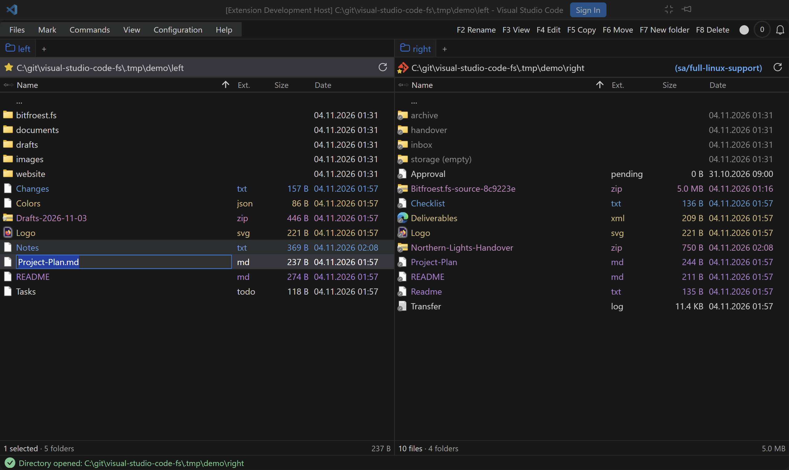

# Bitfroest.fs

**A two-panel file manager inside Visual Studio Code.** Keep two folders in view, organize project files, and check local Git status without leaving the editor.

Bitfroest.fs is for developers managing source and build folders, administrators working with configuration files, and anyone who wants a keyboard-driven way to handle files from Visual Studio Code.

**Beta version** — This extension is under development and may contain bugs or incomplete features.

## What you can do

- Browse two folders side by side, each with its own folder tabs and navigation history.
- Copy, move, rename and delete files, and create folders, with conflict choices and operation progress.
- Search for files and duplicates, and inspect text, binary and hexadecimal content.
- Browse ZIP archives and use supported archive operations.
- View local Git status, configure columns and file colors, and save favorite locations.
- Open a file or folder's Git log with a commit graph, compact commit message and a larger list of changed files. Double-click a changed file to compare its committed versions in the VS Code diff editor.
- Customize shortcuts and settings, with interface text in English or German.

On Windows, the Git file menu also offers **Delete (Keep Local)** and **Delete and Add to Ignore List**. Both keep the local file and stage its removal from Git; the second action adds an exact rule to the `.gitignore` beside the file. Neither action creates a commit. Index changes that would discard staged-only content are refused.

## Get started

Requires Visual Studio Code 1.100.0 or later within the declared compatible version range. Install the pre-release package for your supported operating system and processor. In Visual Studio Code, run **Bitfroest.fs: Show/hide file manager** from the Command Palette, or select its folder button in the Status Bar. Open a source folder in one panel and a destination folder in the other.

The default shortcut is `Ctrl+Alt+Shift+F12` on Windows and Linux. The file manager opens in a separate compact editor window. Run the command again to close it. Existing startup folders are used when available; otherwise, both panels open the existing user home folder. No folders are created when the file manager opens.

## Common shortcuts

| Shortcut | Action |
| --- | --- |
| F2 / Shift+F6 | Rename the selected entry |
| F3 / F4 | View / edit the selected file |
| F5 / F6 | Copy / move the selection |
| F7 | Create a folder |
| F8 | Delete using the configured deletion mode |
| Ctrl+L | Edit the active folder path |
| Ctrl+T / Ctrl+W | Open / close a folder tab |
| Alt+Left / Alt+Right | Navigate backward / forward |
| Alt+F7 | Search for files |

Shortcuts apply in the file manager view. Text fields and ordinary code editors keep their own key bindings. Open **Settings → Keyboard shortcuts** in the file manager to change bindings. Local conflicts must be resolved before saving; external bindings and operating system shortcuts are not checked, and chords are not supported.

<!-- showcase-gallery:start -->
## Feature walkthrough

Windows examples with sample project files. Animations include a pointer highlight and keystroke hints. Drag-and-drop demonstrations stop at the confirmation dialog.

0002 · Copy a folder path

Right-click the address bar and observe the actual clipboard confirmation.

0003 · Select files with the right mouse button

Draw a selection with the right mouse button held down.

0004 · Drag a selection with the right button held

Hold the right mouse button and drag selected files to a destination folder; review the move confirmation.

0005 · Focus the address bar with Ctrl+L

Press Ctrl+L and edit the selected path in the active address bar.

0006 · Commands organized by task

Discover file actions, selection tools, navigation, view options, configuration and help.

0012 · Choose a favorite location

Browse favorite project folders from the location menu.

0013 · Select files by pattern

Enter file masks or regular expressions without applying a selection.

0014 · Remove a group from the selection

Specify the file pattern to remove from the current selection.

0015 · Create a folder

Inspect the folder name and destination before creating anything.

0016 · Create a text file

Inspect the new text-file dialog without creating a file.

0017 · Copy files

Review the destination, overwrite policy and verification options before copying.

0018 · Move files

Review the destination and transfer options before moving files.

0019 · Rename a single entry

Edit the filename in the file list without committing the rename.

0020 · Preview multiple filenames

Inspect naming masks, counters and replacement rules before applying changes.

0021 · Review a recycle-bin deletion

Inspect the confirmation for moving selected entries to the recycle bin.

0022 · Review permanent deletion

Inspect the permanent-deletion warning without confirming it.

0023 · Find files

Inspect basic criteria, advanced filters and saved searches before starting a search.

0026 · Keep a search window open

Open the nonmodal search variant alongside the file manager.

0027 · Inspect file contents

View a real file in text, binary, hexadecimal, HTML-text, Unicode and UTF-8 modes.

0036 · Search inside the viewer

Inspect text-search, direction and matching options.

0037 · Choose another codepage

Inspect the codepage input without saving an encoding preference.

0038 · Prepare a ZIP archive

Inspect compression, encryption and recursive packing options without creating an archive.

0039 · Prepare ZIP extraction

Inspect destination and extraction options without writing files.

0040 · Inspect local Git changes

Show modified, staged and untracked entries in the demonstration repository.

0041 · Browse commit history

Inspect the commit graph, commit message and changed files.

0042 · Compare committed or working versions

Open the actual VS Code diff editor for a selected Git file.

0043 · Inspect available local branches

Open the read-only branch list for the active repository.

0044 · Configure the file manager

Inspect the native integration entry and extension configuration categories.

0045 · Configure favorite locations

Manage favorite locations and groups.

0046 · Configure file-list columns

Inspect column sets, field choices and column visibility.

0047 · Configure keyboard shortcuts

Inspect commands, editable bindings and conflict information.

<!-- showcase-gallery:end -->

## Configuration

Search for `Bitfroest` in the Visual Studio Code Settings editor. Options include file operations, columns, favorites, colors, Git status, archive behavior and interface language. Tab layouts can be stored per workspace or shared across workspaces.

File-list columns support dragging, resizing and content-based autosizing. The standard view hides the attributes column; it can be enabled in the column settings. Directory size cells stay empty until a calculated size is available. The standard date column displays time to the minute. The lists use the editor font and existing icon and row sizes.

The copy and move dialog includes **Compare file contents after copying**, disabled by default. The choice is saved as `bitfroest.files.verifyAfterCopy` for subsequent operations. File identity, size and safety checks remain enabled.

## Platform support

| Platform | Support |
| --- | --- |
| Windows | Primary supported platform, including native Windows integrations |
| Linux | Native file copy, Git index actions, supported desktop capabilities and portable file operations; file clipboard access requires X11 with XFixes or Wayland with ext-data-control-v1. The Windows shell context menu is unavailable |
| macOS | Not supported |

Published Windows and Linux packages target x64 processors. Linux packages target Ubuntu 24.04 or a compatible newer runtime.

Native folder icons on Linux require GIO, GdkPixbuf and installed image loaders. SVG icons require the librsvg loader. On Ubuntu, these runtime components are provided by `libglib2.0-0t64`, `libgdk-pixbuf-2.0-0`, `librsvg2-common` and `shared-mime-info`.

Linux file clipboard access uses the current extension host's desktop session and requires `libxcb.so.1` with `libxcb-xfixes.so.0`, or `libwayland-client.so.0` with compositor permission to use `ext-data-control-v1`. Compositors without that optional protocol cannot expose the system file clipboard to the extension host. Internal copy and paste remain available. A completed move is confirmed by the file-operation backend; another application consuming a cut selection does not provide a standardized move-completion notification. Clipboard contents published by the extension remain available while their native session is active.

When an operating system function is unavailable, the file manager reports it in its lower status bar when that function is used. VS Code remote hosts, browser use and processor architectures beyond the published packages are not covered by a general compatibility claim.

## Beta notice

**Use at your own risk.** The software is provided as is, without warranties, to the extent permitted by applicable law. Warranty and liability are governed by the Apache License 2.0, in particular Sections 7 and 8. Mandatory statutory rights remain unaffected.

**Risk of data loss.** File operations modify real data and may cause unintended data loss. Use copies or test data when evaluating this beta. Where possible, work in a Git repository as an additional safety net, with important changes committed before file operations. Git does not protect untracked or ignored files and does not replace a backup. Only use production data if a current backup that can be restored is available. If there is any doubt about the backup, do not use this extension on production data.

## License and support

Licensed under the [Apache License 2.0](LICENSE). Project attribution is recorded in [NOTICE](NOTICE); third-party component licenses are included under `licenses`. Use the [GitHub issue tracker](https://github.com/s-a/Bitfroest.fs/issues) for project support and bug reports.

The **Licenses and acknowledgements** command opens the bundled notices inside Visual Studio Code.

## Contributing

Development setup, checks, and release procedures are documented in [DEVELOPMENT.md](https://github.com/s-a/Bitfroest.fs/blob/HEAD/DEVELOPMENT.md).
