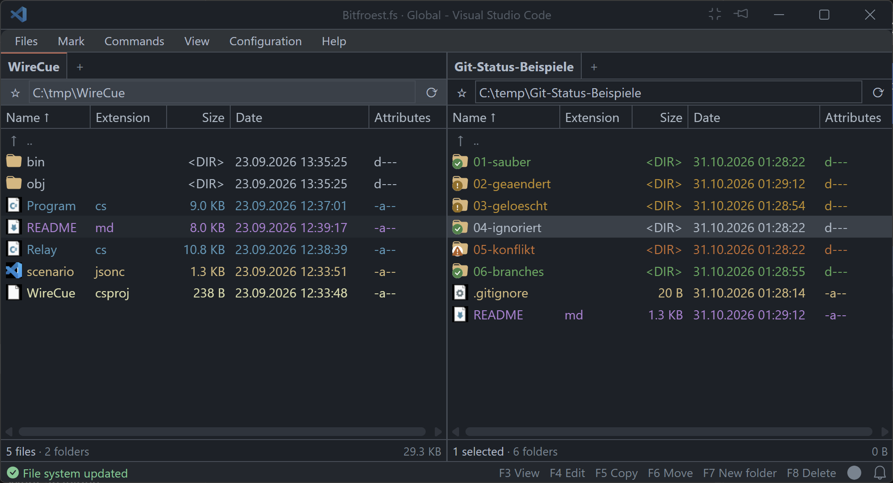

# Bitfroest.fs

**Dual-pane file management for Visual Studio Code.**


Bitfroest.fs adds two file panels to Visual Studio Code. Independent folder tabs, keyboard actions and local Git status support work across source folders, configuration files and build output.

**Beta version** – This extension is under development and may contain bugs or incomplete features.

**Risk of data loss.** File operations modify real data and may cause unintended data loss. Use copies or test data when evaluating this beta. Where possible, work in a Git repository as an additional safety net, with important changes committed before file operations. Git does not protect untracked or ignored files and does not replace a backup. Only use production data if a current backup that can be restored is available. If there is any doubt about the backup, do not use this extension on production data.

## Two folders in one view

Each panel has its own folder tabs and navigation history. Copy and move operations use the selection and the destination panel. File colors, configurable columns and directory favorites help organize frequently used locations.

The location button opens favorites directly in regular folders. In Git repositories and ZIP archives, it shows the current context with a filled-star badge and opens a menu with Favorites first, followed by Git or ZIP actions. Archive context takes precedence inside a ZIP file. Icon colors adapt to the active theme and interaction background.



## Features

| Area | Available functionality |
| --- | --- |
| Navigation | Two panels, independent folder tabs, history and favorites |
| File operations | Copy, move, rename, create directories and delete, with conflict handling and progress reporting |
| Inspection | File search, duplicate search and text, binary and hexadecimal viewing |
| Archives | ZIP browsing and supported archive operations |
| Development | Local Git status and opening files for editing |
| Configuration | Columns, file colors, shortcuts, tab storage and English or German interface text |

Archive support varies by format and operation. The limitations below apply to file operations and platform integration.

## Quick start

Requirements: Visual Studio Code 1.100.0 or later within the declared compatible version range. Windows is the primary supported platform.

1. Install the pre-release package supplied for the supported operating system and processor architecture.
2. Run **Bitfroest.fs: Show/hide file manager** from the Command Palette, or select its folder button in the Status Bar.
3. Open a source folder in one panel and a destination folder in the other.
4. Evaluate file operations with disposable copies before using important data.

The default opening shortcut is `Ctrl+Alt+Shift+F12` on Windows and Linux. The file manager opens in a separate compact editor window. Running the command again closes the visible file manager. Existing startup directories are used when available; otherwise, both panels open the existing user home directory. Opening the file manager does not create directories.

## Keyboard reference

| Key | Action |
| --- | --- |
| F2 / Shift+F6 | Rename the current entry |
| Ctrl+R | Refresh the file list |
| F3 | View the current file |
| F4 | Open the file for editing |
| F5 / F6 | Copy / move the selection |
| F7 | Create a directory |
| F8 | Delete using the configured deletion mode |
| Shift+F8 / Shift+Delete | Use the opposite deletion mode |
| F9 | Open a Windows Terminal tab here on Windows; open an integrated terminal on Linux |
| Ctrl+T / Ctrl+W | Open / close a folder tab |
| Alt+Left / Alt+Right | Navigate backward / forward |
| Alt+F7 | Open file search |

On Windows, F9 opens Windows PowerShell in Windows Terminal and reuses the last active terminal window. Keyboard actions apply within the relevant file manager view. Text fields and ordinary code editors retain their own bindings.

## Settings and saved layouts

Open the Visual Studio Code Settings editor and search for `Bitfroest`. Settings cover file operations, columns, favorites, colors, Git status, archive options and interface language. Tab layouts can be stored per workspace or shared across workspaces.

`bitfroest.appearance.iconSize` sets the shared icon frame size (default: 16 pixels; range: 12–48). Badges, text spacing and required control heights scale with this value. Changes apply immediately without changing the text size. Existing Git badge percentage overrides remain available.

Column settings include numeric file versions, version strings, comments, file types and individual attributes. Version fields read EXE/DLL resources on Windows and Linux. Windows-only attributes and DOS names are disabled on other operating systems. Attribute text uses Windows flags on Windows and POSIX permissions on Linux; POSIX read-only status reflects mode bits rather than an ACL check.

Comments are read from `descript.ion` and `files.bbs` in the listed directory. `descript.ion` takes precedence when both contain a comment for the same file. Unicode byte order marks determine the encoding; otherwise `bitfroest.files.commentEncoding` applies, with `windows-1252` as the default. Refresh the directory after changing this setting. DOS names remain unavailable where no short name exists.

`bitfroest.files.useSystemContextMenu` defaults to `false`. Own menus use the same compact font as the menu bar, with mapped icons and consistent keyboard shortcut labels. Hover switches an open menu category and opens child menus without executing commands. Child menus open beside their parent, switching left or upward when space is limited. File and folder tab context menus display keyboard shortcuts in the same style as the main menu. The address bar has no context menu; its path input retains native text editing. File lists use a menu with Copy, Cut, Paste and, for a single folder on Windows or Linux, folder lock inspection. Enabling the setting uses the Windows system context menu. Hidden entries remain visible and carry an eye-closed marker. Windows uses the native hidden attribute; Linux uses dot-prefixed names. Cut sources have faded icons and names with an arrow marker from the bundled icon font. Markers appear to the left of the original file icon and preserve filename alignment. Copied sources have a narrow diagonal hatch strip beside the file icon. The strip space remains reserved in every row to keep names aligned. These markers describe the current file manager clipboard selection. Escape in the file list cancels a prepared copy or cut after any active filter or menu is closed. During an active transfer, Escape retains its transfer cancellation behavior. Newer clipboard contents from other applications are preserved. Paste is enabled when a supported file selection is available. Pasting starts the transfer into the active panel directly; an existing destination name opens the conflict decision. Explicit Copy and Move commands retain their destination dialog. While a refresh indicator is animated, the lower status bar identifies directory reading, file metadata reading or Git status queries for each busy panel and path. Clipboard availability is checked when opening the file manager and returning focus, and updated after clipboard changes in the file manager.

The file manager's **Settings** menu opens a searchable settings window. Its **Keyboard shortcuts** section supports alternative combinations, removal of bindings and restoration of defaults. Local conflicts block saving until resolved. Overrides are stored in `bitfroest.shortcuts.bindings`. An empty value disables a binding; removing an override restores the inherited value or default. External bindings and operating system shortcuts are not checked. Chords are not supported.

## Platform support and limitations

| Platform | Scope |
| --- | --- |
| Windows | Primary supported platform, including implemented native Windows integrations |
| Linux | Implemented native capabilities and portable file operations; no system file clipboard or Windows shell context menu |
| macOS | Not supported |

Unsupported operating system functions display a message in the file manager status bar when invoked.

Symbolic links and junctions are displayed but cannot be traversed or modified. Copy publication requires a filesystem that supports hard links. Before publication, copied file contents are compared with the sources using bounded buffers. This comparison does not provide an independent physical-disk integrity check.

Some archive formats, compression methods and integration features are unavailable. Cancellation may wait for the current native copy to finish on platforms without granular cancellation support. Native window and focus behavior requires broader validation.

Remote hosts, browser operation and additional processor architectures are not covered by a general compatibility claim in this documentation.

## Development

Prerequisites are Node.js, npm and Visual Studio Code compatible with the engine range in `package.json`.

```sh
npm ci
npm run check
npm run lint
npm test
```

`Start-Development.ps1` opens a development window with automatic reload. A launch configuration is also provided under `.vscode`.

## Beta packaging

The extension uses the Marketplace pre-release channel:

```sh
npm run package:beta -- --out /absolute/path/bitfroest-fs.vsix
```

The output file belongs outside the source directory. `npm run publish:beta` publishes through the configured Marketplace account and requires valid publisher credentials. Packaging and publishing require access to the packaging tool or an existing npm cache.

## GitHub builds and releases

GitHub Actions builds the native module and packages the extension for Windows x64 and Linux x64. Linux builds target Ubuntu 24.04 or a compatible newer runtime and retain the limited Linux feature scope described above. The workflow checks syntax, lint, native API behavior, Electron compatibility and isolated package loading. Each VSIX includes its compiled module and runtime dependencies; no compiler is required on the user's computer.

An experimental macOS ARM64 build is also attempted. Successful experimental packages are available as Actions artifacts only. They do not establish official macOS support and are excluded from regular release downloads.

Branch builds retain their VSIX packages, SHA-256 checksums and build metadata as Actions artifacts for 14 days. Pushing a numeric version tag such as `v0.0.28` creates a GitHub Release after all supported target builds succeed. The tag must match the versions in `package.json` and `package-lock.json`. Beta packages are published as GitHub pre-releases. Existing releases are not overwritten; an interrupted upload may leave a draft for inspection. Marketplace publication is separate.

## License

The project is licensed under the [Apache License 2.0](LICENSE). Project attribution is recorded in [NOTICE](NOTICE). Third-party components retain their own licenses; the component list and complete license texts are included under `licenses`.

The **Licenses and acknowledgements** command opens the bundled notices inside Visual Studio Code.
