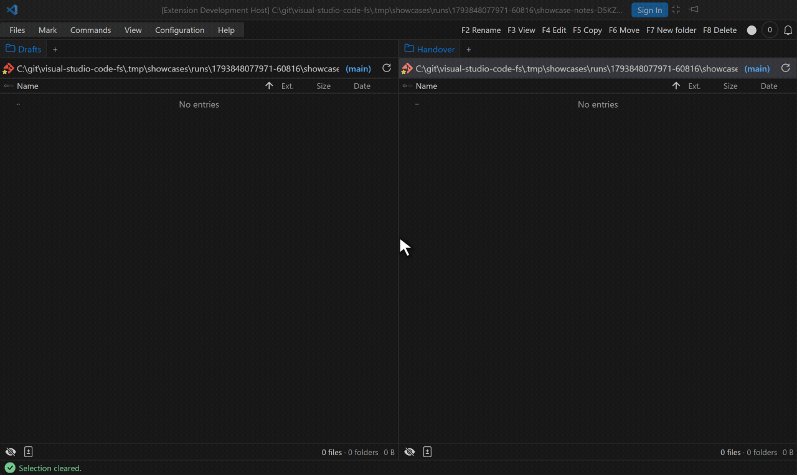
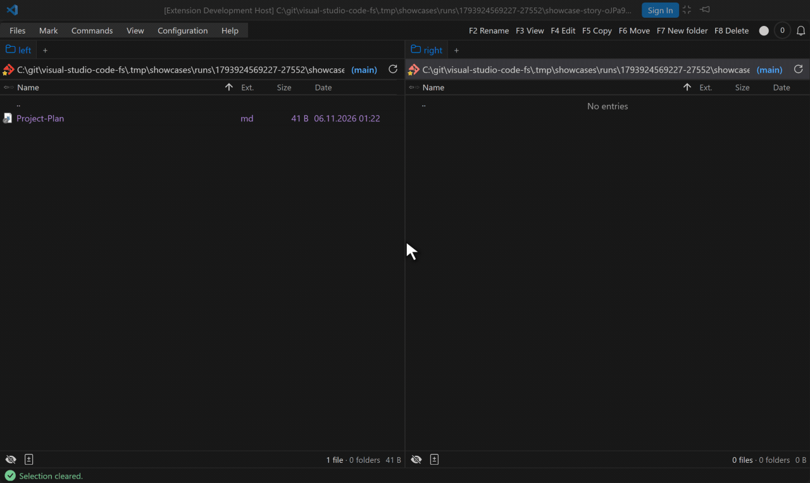
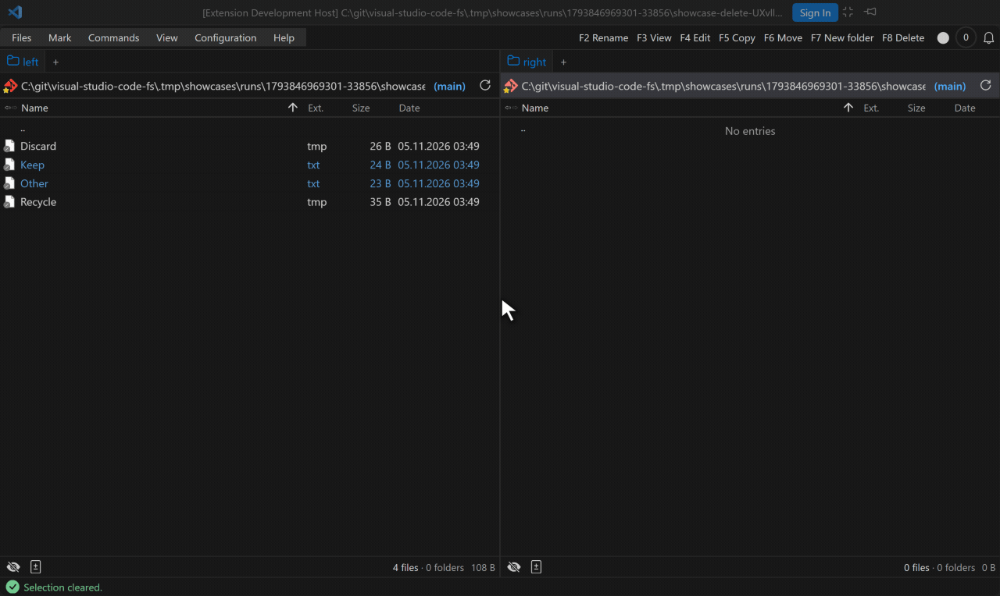
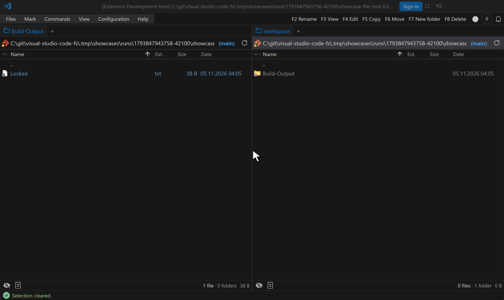

# Bitfroest.fs

**A two-panel file manager for Visual Studio Code.** File operations, folder tabs and Git views share a compact editor window.

**Beta version** — This extension is under development and may contain bugs or incomplete features.

## Get started

Requires Visual Studio Code 1.100.0 or later within the declared compatible version range. Install the pre-release package for a supported operating system and processor. The Command Palette entry **Bitfroest.fs: Show/hide file manager** or its folder button on the left of the Status Bar opens the file manager.

The default shortcut is `Ctrl+Alt+Shift+F12` on Windows and Linux. Repeating the command closes the window. Each panel has its own folder tabs and navigation history. Keyboard shortcuts can be customized in VS Code.

When the file system refuses a deletion, the file manager identifies the affected entry and reports how many entries were already deleted. **Inspect file locks** opens the lock inspector on Windows and Linux.

<!-- showcase-gallery:start -->
## Feature walkthrough

Windows examples with isolated sample files.

### Basic File Operations

<kbd>F7</kbd> <kbd>F5</kbd> <kbd>F2</kbd> Prepare a project handover

<kbd>Shift+F4</kbd> <kbd>Ctrl+A</kbd> <kbd>F6</kbd> <kbd>Ctrl+M</kbd> <kbd>Ctrl+Numpad-</kbd> Create and organize handover notes

<kbd>F8</kbd> <kbd>Shift+F8</kbd> Remove temporary files

### File &amp; Folder Locks

<kbd>Shift+F8</kbd> <kbd>F5</kbd> Find the process using a locked file

This recording shows the previous confirmation dialog style.

<!-- showcase-gallery:end -->

## Hidden features and mouse gestures

### Address bar and tabs

| Where | Gesture | Result |
| --- | --- | --- |
| Address bar breadcrumb | Ctrl-click | Open that folder in a new tab in the same panel. |
| Address bar breadcrumb | Right-click | Copy the full current address to the clipboard. |
| Space after the breadcrumbs | Click | Edit the current address. |
| Address text field | Right-click | Open the text menu while keeping the selected part of the address highlighted. |
| Address bar icon | Click | Open favorites and any Git or ZIP actions available for the current location. On Windows, drive roots such as `C:\` appear at the bottom, starting with the system drive. A divider separates the drives from up to ten recently visited UNC share roots. |
| Back or forward arrow | Right-click | Show the current tab's full history, including forward entries. |
| Folder tab | Double-click or middle-click | Close the tab. Each panel keeps at least one tab. |
| Folder tab | Drag or Ctrl-drag | Drag to reorder or move a tab. Hold Ctrl while dragging to copy it. Dragging the only tab to the other panel also copies it. |

### File list and drop targets

| Where | Gesture | Result |
| --- | --- | --- |
| File list | Start dragging immediately with the right mouse button | Select entries with a rectangle. Hold Ctrl or Shift to extend the selection. |
| File row | Hold the right mouse button until the drag indicator appears, then drag | Move the selection after confirmation. |
| File row | Left-drag, with Shift to move | Copy by default. A folder row, the parent row (`..`) or an inactive tab can serve as the destination. |
| File or folder row | Right-click → **Send to** | Choose a configured favorite, then select **Copy** or **Move**. The standard transfer dialog opens with the favorite as the destination. Review the selection and destination before confirming. |
| Folder under the cursor | Press Space | Mark the folder and calculate its recursive size when folder sizing on Space is enabled. |
| Column separator | Double-click | Fit the column to its contents. |

When moving a folder with **Send to**, an existing folder with the same name is merged with the source. Files outside the transfer remain in the destination, including files added or replaced while it runs.

The transfer filter applies to the selected files and the contents of selected folders. The default `*.*` includes all file types within that selection.

Copy, move and delete update the affected entries in open folder tabs after the operation is confirmed.
A folder selected in its parent directory can be deleted while it is open in the other pane. If its tab is the only one in that pane, the pane opens the parent directory. Configured roots and filesystem roots are protected from deletion.

When the selected files have known sizes, the status bar can show overall byte progress across conflict prompts. During copying or moving, the file indicator shows the source file currently being transferred.

### Preview controls

When the window regains focus, Bitfroest.fs checks the open folders and leaves unchanged views in place. X-Ray and Quick Diff keep their scroll position when the displayed file is updated.

| Where | Gesture | Result |
| --- | --- | --- |
| X-Ray eye in the panel footer | Click or right-click | Click to cycle through Off, Click and Hover. Right-click to turn X-Ray off. |
| Quick Diff in the panel footer | Click or right-click | Click to cycle through the current folder, the repository and Off. Right-click to exit. |
| Quick Diff result | Double-click | Return to the regular file list and select that entry. |

### File search

| Where | Gesture | Result |
| --- | --- | --- |
| Search field with history | Shift+Delete | Remove the current value from that field's search history. |

### Operations and status

| Where | Gesture | Result |
| --- | --- | --- |
| Outside a modal dialog | Click | Dismiss the dialog. |
| Editable text, including a file name during rename | Right-click | Open the text menu and keep the selection highlighted. |
| Jobs counter | Click | Show running and queued operations. Select a job to reveal its destination, or use its cancel button to cancel it. |
| Status message icon | Click | Copy the status message and its work log. |

## Configuration

The **Configuration** menu opens settings for file operations, favorites, columns and shortcuts. Additional options are available by searching for `Bitfroest` in VS Code Settings. Tab layouts can be stored per workspace or shared across workspaces.

## Platform support

| Platform | Support |
| --- | --- |
| Windows | Primary supported platform, including native Windows integrations |
| Linux | Native file copy, symbolic links, Git index actions, supported desktop capabilities and portable file operations. File clipboard access uses X11, supported Wayland data-control protocols or an existing XWayland connection. The Windows shell context menu is unavailable |
| macOS | No official support. An experimental Marketplace pre-release is available for Apple Silicon (ARM64) |

Published Windows and Linux packages target x64 processors. Linux packages target Ubuntu 24.04 or a compatible newer runtime.

On Apple Silicon, select **Install Pre-Release Version** in the VS Code Extensions view. Use disposable files for testing. The system file clipboard, native context menu, opening files in their associated applications, and the Trash view are unavailable on macOS. Include the macOS, VS Code, and extension versions and steps to reproduce when reporting an issue. [Report a bug](https://github.com/s-a/Bitfroest.fs/issues/new?template=bug-report.yml)

Native folder icons on Linux require GIO, GdkPixbuf and installed image loaders. SVG icons require the librsvg loader. On Ubuntu, these runtime components are provided by `libglib2.0-0t64`, `libgdk-pixbuf-2.0-0`, `librsvg2-common` and `shared-mime-info`.

Linux copies preserve symbolic links as links, including relative and dangling targets. Explicitly opening a directory link navigates to its canonical target within the permitted roots. Recursive copy and deletion do not traverse link targets. Copy publication does not require hardlinks. Native copying preserves file and directory permissions, ownership, timestamps, extended attributes and POSIX ACLs when the filesystem and current permissions allow them; metadata failures are reported. Sparse files retain holes where the filesystem exposes data and hole ranges. Symbolic-link extended attributes require an API that can address the held link identity; copying a link carrying such attributes currently reports an unsupported-metadata error.

Linux file clipboard access uses the current extension host's desktop session. It requires `libxcb.so.1` with `libxcb-xfixes.so.0`, or `libwayland-client.so.0` with permission to use `ext-data-control-v1` or `wlr-data-control`. Wayland sessions without these protocols can use an already running XWayland server identified through its public extension; the extension does not start XWayland. Private integration tests cover Mutter 46.2 through XWayland and KWin 5.27 through data control. A named Wayland display is required; an inherited `WAYLAND_SOCKET` connection is not shared between native sessions. Sessions exposing neither permitted data control nor XWayland cannot provide system file clipboard access. Internal copy and paste remain available.

A completed move is confirmed by the file-operation backend. Partial completion updates the payload served by the owned clipboard source; clients that have already cached its contents receive no guaranteed refresh notification. Another application consuming a cut selection does not provide a standardized move-completion notification. Clipboard contents published by the extension remain available while their native session is active.

When an operating system function is unavailable, the file manager reports it in its lower status bar when that function is used. VS Code remote hosts, browser use and processor architectures beyond the published packages are not covered by a general compatibility claim.

## Beta notice

**Use at your own risk.** The software is provided as is, without warranties, to the extent permitted by applicable law. Warranty and liability are governed by the Apache License 2.0, in particular Sections 7 and 8. Mandatory statutory rights remain unaffected.

**Risk of data loss.** File operations modify real data and may cause unintended data loss. Use copies or test data when evaluating this beta. Where possible, work in a Git repository as an additional safety net, with important changes committed before file operations. Git does not protect untracked or ignored files and does not replace a backup. Only use production data if a current backup that can be restored is available. If there is any doubt about the backup, do not use this extension on production data.

## Features and default shortcuts

Shortcuts apply to the file manager unless a different context is stated. They can be customized in **Configuration → Shortcuts**. A dash indicates that no default shortcut is assigned.

| Area | Feature | Default shortcut |
| --- | --- | --- |
| File operations | Create a folder | `F7` |
| File operations | Create a folder in the opposite pane | `Shift+F7` |
| File operations | Create a text file | `Shift+F4` |
| File operations | Copy selected entries | `F5` |
| File operations | Move selected entries | `F6` |
| File operations | Copy in the current folder | `Shift+F5` |
| File operations | Rename an entry | `F2` or `Shift+F6` |
| File operations | Rename multiple entries | `Ctrl+M` |
| File operations | Delete selected entries | `F8` or `Delete` |
| File operations | Delete selected entries permanently | `Shift+F8` or `Shift+Delete` |
| File operations | Copy files to the clipboard | `Ctrl+C` |
| File operations | Cut files to the clipboard | `Ctrl+X` |
| File operations | Paste files from the clipboard | `Ctrl+V` |
| File operations | Copy or move files by drag and drop | — |
| File operations | Open the recycle bin | — |
| File operations | Inspect folder locks and references | — |
| File operations | Open the file context menu | `Context Menu` |
| File operations | Open the operating system context menu (Windows; when enabled in settings) | `Shift+F10` |
| Navigation | Switch panes | `Tab` |
| Navigation | Open an entry | `Enter` |
| Navigation | Go to the parent folder | `Backspace` |
| Navigation | Enter a path | `Ctrl+L` |
| Navigation | Open a path from the clipboard | `Ctrl+Shift+L` |
| Navigation | Previous folder in history | `Alt+Left` |
| Navigation | Next folder in history | `Alt+Right` |
| Navigation | Open favorites | `Ctrl+D` |
| Navigation | Create a folder tab | `Ctrl+T` |
| Navigation | Close a folder tab | `Ctrl+W` |
| Navigation | Next folder tab | `Ctrl+Tab` |
| Navigation | Previous folder tab | `Ctrl+Shift+Tab` |
| Navigation | Open the folder under the cursor in a new tab | `Ctrl+Up` |
| Navigation | Open the folder under the cursor in a tab in the opposite pane | `Ctrl+Shift+Up` |
| Navigation | Create a background folder tab | `Ctrl+Shift+T` |
| Navigation | Swap current paths | `Ctrl+U` |
| Navigation | Swap panes | `Ctrl+Shift+U` |
| Navigation | Move the cursor through the file list | `Up` / `Down`, `Home` / `End`, `Page Up` / `Page Down` |
| Navigation | Refresh the file list | `Ctrl+R` |
| Selection | Toggle selection | `Space` |
| Selection | Toggle selection and move to the next entry | `Insert` |
| Selection | Select entries with mouse clicks or right-button dragging | — |
| Selection | Select all | `Ctrl+A` |
| Selection | Clear selection | `Ctrl+Numpad-` |
| Selection | Select a group | `Numpad+` |
| Selection | Unselect a group | `Numpad-` |
| Selection | Invert selection | `Numpad*` |
| Selection | Temporarily reverse the folder-selection setting for group selection or inversion | `Shift+Numpad+` / `Shift+Numpad*` |
| Selection | Unselect a group without clearing folder selections | `Shift+Numpad-` |
| Selection | Clear selection while retaining folder selections | `Ctrl+Shift+Numpad-` |
| Selection | Select files with the same extension | `Ctrl+Numpad+` or `Alt+Numpad+` |
| Selection | Unselect files with the same extension | `Alt+Numpad-` |
| Selection | Save the selection in memory | — |
| Selection | Restore the saved selection | `Numpad/` |
| Selection | Save the selection to a file | — |
| Selection | Load a selection from a file | — |
| Selection | Copy selected names | — |
| Selection | Copy selected names with full paths | `Ctrl+Y` |
| Selection | Copy selected full paths with forward slashes | `Ctrl+Shift+Y` |
| Selection | Copy selected names with details | — |
| Selection | Copy selected names with paths and details | — |
| Search | Find files | `Alt+F7` |
| Search | Find files in a separate window | `Alt+Shift+F7` |
| Search | Search the current file list | `Ctrl+F` |
| Search | Select matches | `Ctrl+B` |
| Search | Show only matches | `Ctrl+Shift+F` |
| Search | Clear the current file-list filter | `Escape` in the file list |
| Search | Select duplicate search results | `Numpad+` in search results |
| Archives | Browse ZIP archives | — |
| Archives | Pack files | `Alt+F5` |
| Archives | Pack files and remove sources | `Alt+Shift+F5` |
| Archives | Unpack files | `Alt+F9` or `Alt+F6` |
| Archives | Test ZIP archives | `Alt+Shift+F9` |
| View | View a file | `F3` |
| View | Edit a file | `F4` |
| View | Search within the file viewer | `F7` or `Ctrl+F` in the viewer |
| File viewer | Reload / edit the current file | `F2` / `F4` |
| File viewer | Next / previous search match | `F3` or `F5` or `Shift+F7` / `Shift+F3` or `Shift+F5` |
| File viewer | Reverse the search direction | `Ctrl+F3` or `Ctrl+F5` |
| File viewer | Toggle the text cursor | `F6` |
| File viewer | Select all / copy selection / copy as hexadecimal | `Ctrl+A` / `Ctrl+C` / `Ctrl+Shift+C` |
| File viewer | Go to the beginning / end | `Ctrl+Home` / `Ctrl+End` |
| File viewer | Select to the beginning / end | `Ctrl+Shift+Home` / `Ctrl+Shift+End` |
| File viewer | Close the viewer | `Escape` |
| View | X-Ray preview | — |
| View | Quick Diff | — |
| View | Sort by name, extension, date or size | — |
| View | Calculate folder sizes | `Alt+Shift+Enter` |
| View | Configure columns and file colors | — |
| View | Inspect and cancel running operations | — |
| Git | Show repository status and branches | — |
| Git | Show a file diff | — |
| Git | Show file or folder history | — |
| Git | Remove a file from the Git index and keep it locally | — |
| Git | Remove a file from the Git index and add it to the ignore list | — |
| Copy and move conflicts | View the destination / source | `F3` / `Shift+F3` |
| Copy and move conflicts | View the destination / source without a preview provider | `Alt+F3` / `Alt+Shift+F3` |
| Copy and move conflicts | Compare files / compare internally | `Ctrl+F3` / `Ctrl+Shift+F3` |
| Copy and move dialogs | Select file name parts | `F5` / `F6` in the destination field |
| Copy and move dialogs | Move to the start of the file name | `Ctrl+Home` in the destination field |
| Tools | Open a terminal in the current folder | `F9` |
| Tools | Show / hide the file manager | `Ctrl+Alt+Shift+F12` |
| Tools | Configure favorites, columns, shortcuts and folder-tab storage | — |
| Tools | Change the interface language | — |
| Tools | Open licenses and acknowledgements | — |

File-search dialog access keys depend on the interface language. Platform and desktop-session restrictions are described under [Platform support](#platform-support).

## License and support

Licensed under the [Apache License 2.0](LICENSE). Project attribution is recorded in [NOTICE](NOTICE); third-party component licenses are included under `licenses`. Use the [GitHub issue tracker](https://github.com/s-a/Bitfroest.fs/issues) for project support and bug reports.

**Copy Details** in a file operation error dialog copies the available diagnostic information. For transfer failures, this can include the triggering command, selected files, destination and error code. Recognized paths are shortened. Stack frames retain function names, file names and line numbers.

The status bar's **Copy message and activity log** action includes transfer confirmations, conflict decisions, host acknowledgements and outcomes. Review the activity log before sharing it because it can include local paths.

**Report on GitHub** opens a prefilled issue for review. The report includes a shortened error message, error codes and version information. Recognized paths retain up to three trailing components, which may contain names. Recognized URLs are masked. Stack traces and panel paths are excluded.

Community testing, contributions and feedback are welcome and appreciated. Linux bug reports are most useful with the distribution and version, desktop environment, X11 or Wayland session type, and steps to reproduce. The remaining platform limits are described above.

The **Licenses and acknowledgements** command opens the bundled notices inside Visual Studio Code.

## Contributing

Development setup, checks, and release procedures are documented in [DEVELOPMENT.md](https://github.com/s-a/Bitfroest.fs/blob/HEAD/DEVELOPMENT.md).
