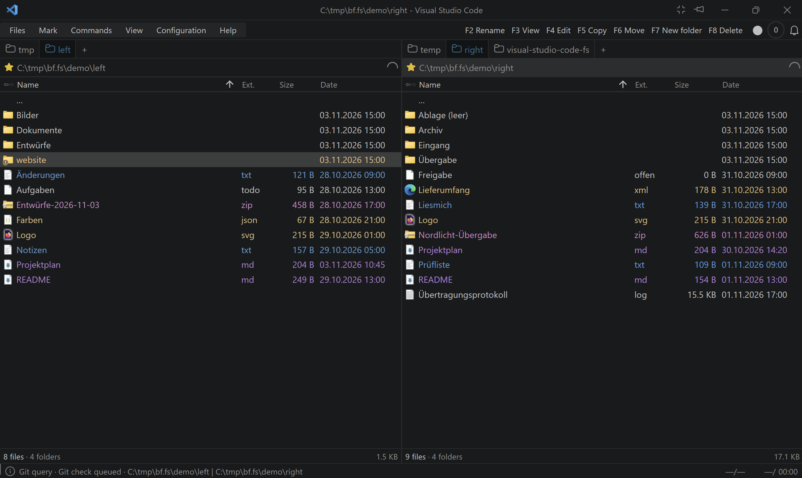

# Bitfroest.fs

**A two-panel file manager inside Visual Studio Code.** Keep two folders in view, organize project files, and check local Git status without leaving the editor.

Bitfroest.fs is for developers managing source and build folders, administrators working with configuration files, and anyone who wants a keyboard-driven way to handle files from Visual Studio Code.

**Beta version** — This extension is under development and may contain bugs or incomplete features.

## What you can do

- Browse two folders side by side, each with its own folder tabs and navigation history.
- Copy, move, rename and delete files, and create folders, with conflict choices and operation progress.
- Search for files and duplicates, and inspect text, binary and hexadecimal content.
- Browse ZIP archives and use supported archive operations.
- View local Git status, configure columns and file colors, and save favorite locations.
- Customize shortcuts and settings, with interface text in English or German.

## Get started

Requires Visual Studio Code 1.100.0 or later within the declared compatible version range. Install the pre-release package for your supported operating system and processor. In Visual Studio Code, run **Bitfroest.fs: Show/hide file manager** from the Command Palette, or select its folder button in the Status Bar. Open a source folder in one panel and a destination folder in the other.

The default shortcut is `Ctrl+Alt+Shift+F12` on Windows and Linux. The file manager opens in a separate compact editor window. Run the command again to close it. Existing startup folders are used when available; otherwise, both panels open the existing user home folder. No folders are created when the file manager opens.

## Common shortcuts

| Shortcut | Action |
| --- | --- |
| F2 / Shift+F6 | Rename the selected entry |
| F3 / F4 | View / edit the selected file |
| F5 / F6 | Copy / move the selection |
| F7 | Create a folder |
| F8 | Delete using the configured deletion mode |
| Ctrl+T / Ctrl+W | Open / close a folder tab |
| Alt+Left / Alt+Right | Navigate backward / forward |
| Alt+F7 | Search for files |

Shortcuts apply in the file manager view. Text fields and ordinary code editors keep their own key bindings. Open **Settings → Keyboard shortcuts** in the file manager to change bindings. Local conflicts must be resolved before saving; external bindings and operating system shortcuts are not checked, and chords are not supported.

## Configuration

Search for `Bitfroest` in the Visual Studio Code Settings editor. Options include file operations, columns, favorites, colors, Git status, archive behavior and interface language. Tab layouts can be stored per workspace or shared across workspaces.

The copy and move dialog includes **Compare file contents after copying**, disabled by default. The choice is saved as `bitfroest.files.verifyAfterCopy` for subsequent operations. File identity, size and safety checks remain enabled.

## Platform support

| Platform | Support |
| --- | --- |
| Windows | Primary supported platform, including native Windows integrations |
| Linux | Supported native capabilities and portable file operations; the system file clipboard and Windows shell context menu are unavailable |
| macOS | Not supported |

Published Windows and Linux packages target x64 processors. Linux packages target Ubuntu 24.04 or a compatible newer runtime.

When an operating system function is unavailable, the file manager reports it in its lower status bar when that function is used. VS Code remote hosts, browser use and processor architectures beyond the published packages are not covered by a general compatibility claim.

## Beta notice

**Use at your own risk.** The software is provided as is, without warranties, to the extent permitted by applicable law. Warranty and liability are governed by the Apache License 2.0, in particular Sections 7 and 8. Mandatory statutory rights remain unaffected.

**Risk of data loss.** File operations modify real data and may cause unintended data loss. Use copies or test data when evaluating this beta. Where possible, work in a Git repository as an additional safety net, with important changes committed before file operations. Git does not protect untracked or ignored files and does not replace a backup. Only use production data if a current backup that can be restored is available. If there is any doubt about the backup, do not use this extension on production data.

## License and support

Licensed under the [Apache License 2.0](LICENSE). Project attribution is recorded in [NOTICE](NOTICE); third-party component licenses are included under `licenses`. Use the [GitHub issue tracker](https://github.com/s-a/Bitfroest.fs/issues) for project support and bug reports.

The **Licenses and acknowledgements** command opens the bundled notices inside Visual Studio Code.

## Contributing

Development setup, checks, and release procedures are documented in [DEVELOPMENT.md](https://github.com/s-a/Bitfroest.fs/blob/HEAD/DEVELOPMENT.md).
